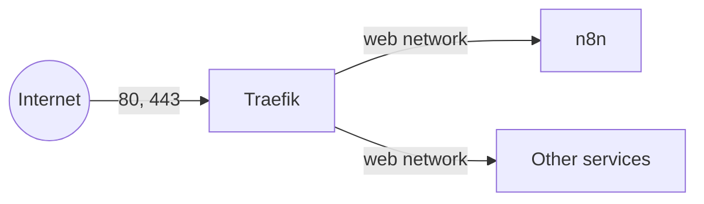

# Self-Hosted n8n Template

A Docker Compose template for self-hosting n8n on a single VPS, with Traefik in front for HTTPS. It reflects a production setup that has been running for about a year, not a toy example.

The stack is n8n in queue mode (PostgreSQL and Redis) behind a Traefik reverse proxy, with Code node code running in separate, locked-down task runner containers. Traefik lives in its own folder so it can be reused for other services too, but the focus here is a solid n8n deployment.

Each part lives in its own folder with its own `docker-compose.yml`, `.env.example`, and README. Secrets and your own settings live in git-ignored files (`.env`, and Traefik's `traefik.yml`), so nothing personal is baked into the committed files and `git pull` never overwrites your configuration.

## What is inside

- `traefik/` - Traefik v3 reverse proxy. Terminates HTTPS with automatic Let's Encrypt certificates and routes traffic to your other services. Includes a configuration for servers behind Cloudflare. Set this up first.
- `n8n/` - Self-hosted n8n in queue mode, with PostgreSQL, Redis and external task runners, sitting behind Traefik. Pinned to an exact n8n version, with a script that moves it to the newest stable release, and ready for n8n 3.0.

## How it fits together

Traefik is the front door. It owns ports 80 and 443 and shares a Docker network called `web` with every service it routes to. Each service (like n8n) joins that `web` network and tells Traefik how to route to it using labels. The services themselves publish no ports.

So the order is:

1. Set up `traefik/` and create the shared `web` network.
2. Set up `n8n/` (or any other service) and let Traefik route to it.

## Prerequisites

- A VPS with Docker and Docker Compose installed.
- A domain name, with DNS records pointing at the server.

## Getting started

Start with the Traefik README, then the service you want:

- [traefik/README.md](traefik/README.md)
- [n8n/README.md](n8n/README.md)

## A note on security

Services bind only to internal Docker networks and publish no ports, so the only things exposed to the internet are Traefik's ports 80 and 443. Keep your `.env` files private (they hold real passwords and keys, so `chmod 600` them) and make sure `acme.json` stays `chmod 600`.
