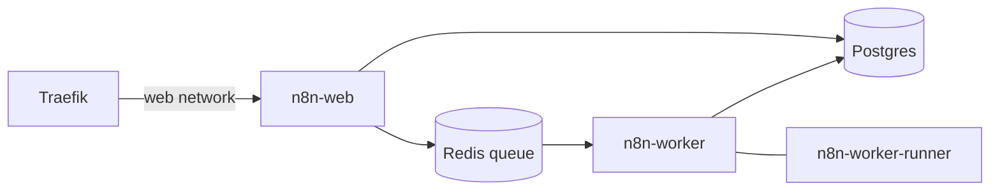

# n8n

Self-hosted n8n in queue mode, with PostgreSQL and Redis, running behind Traefik for HTTPS.

Queue mode splits the work between a main process (the editor and webhooks) and a worker process that runs your workflows. Code from Code nodes runs in a separate task runner container beside the worker, as n8n recommends for production. The main process needs no runner, because every execution, manual ones included, runs on the worker.



The runner shares a private network only with its worker, with no internet access, so code in a Code node cannot reach Postgres, Redis or anything outside. The runner image is the hardened `-distroless` variant, running as an unprivileged user with a read-only filesystem. JavaScript and Python Code nodes both work.

## Containers

Every image is pinned to an exact version, so nothing changes until you change it.

| Container | Image | What it does |
|---|---|---|
| `n8n-web` | `n8nio/n8n:<N8N_VERSION>` | The main instance: the editor, the API, webhooks and triggers. It puts each execution on the queue. |
| `n8n-worker` | `n8nio/n8n:<N8N_VERSION>` | Takes executions off the queue and runs them, manual runs from the editor included. |
| `n8n-worker-runner` | `n8nio/runners:<N8N_VERSION>-distroless` | Runs Code node code for its worker. It must be the same version as n8n, so it uses the same `N8N_VERSION`. |
| `postgres` | `postgres:18.7` | The database: workflows, encrypted credentials, execution history, and files that pass through workflows. |
| `redis` | `redis:8.10.3-alpine` | The queue between the main instance and the workers. |

Traefik, in front of n8n, lives in the `traefik/` folder (`traefik:v3.7.19`).

Queue mode is what needs Redis and a worker. Without it, n8n runs every execution inside the main instance and needs only Postgres and a runner. This template uses queue mode so heavy workflows never slow the editor down, and so you can add workers later.

## Prerequisites

- Docker and Docker Compose
- Traefik running with a shared `web` external network (see the `traefik/` folder)

## Setup

1. Copy the example env file and fill in your values. Generate `N8N_ENCRYPTION_KEY` and `N8N_RUNNERS_AUTH_TOKEN` with `openssl rand -hex 32`, and keep the file private:
   ```bash
   cp .env.example .env
   chmod 600 .env
   ```

2. Create the external Docker network (skip if Traefik already made it):
   ```bash
   docker network create web
   ```

3. Start the stack:
   ```bash
   docker compose up -d --wait
   ```

4. Open the editor at `https://<N8N_EDITOR_SUBDOMAIN>.<DOMAIN_NAME>` once Traefik has issued the certificate, and create the owner account straight away. Until you do, whoever opens the editor first can create it.

Keep a copy of `N8N_ENCRYPTION_KEY` somewhere safe outside this server. Without it, the credentials stored in the database cannot be decrypted.

## Settings

### Your values, in `.env`

`.env.example` lists them all with comments.

| Setting | What to put |
|---|---|
| `POSTGRES_DB`, `POSTGRES_USER`, `POSTGRES_PASSWORD` | The database name, user and a long random password. |
| `N8N_VERSION` | The exact n8n version to run, for example `2.48.7`. `update-n8n.sh` keeps it current. |
| `N8N_UPDATE_CHANNEL`, `N8N_AUTO_UPDATE_MAJOR`, `N8N_UPDATE_KEEP_BACKUPS` | How `update-n8n.sh` updates (see "Versions and updates"). |
| `N8N_ENCRYPTION_KEY` | `openssl rand -hex 32`. n8n encrypts stored credentials with it. Back it up. |
| `N8N_EDITOR_SUBDOMAIN`, `N8N_WEBHOOK_SUBDOMAIN`, `DOMAIN_NAME` | The editor and webhook hostnames, for example `n8n` and `hooks-n8n` on `example.com`. Both need DNS records pointing at the server. |
| `N8N_PROTOCOL` | `https`. |
| `N8N_PROXY_HOPS` | How many reverse proxies sit in front of n8n: `1` for Traefik alone, `2` for Cloudflare plus Traefik. |
| `REDIS_PASSWORD` | A long random password. |
| `N8N_RUNNERS_AUTH_TOKEN` | `openssl rand -hex 32`. Shared by each worker and its task runner. |
| `GENERIC_TIMEZONE` | Your timezone, for example `Australia/Sydney`. Schedule Trigger nodes use it. |
| `N8N_SMTP_HOST`, `N8N_SMTP_PORT`, `N8N_SMTP_USER`, `N8N_SMTP_PASS`, `N8N_SMTP_SENDER` | The mail server for invitations and password resets. |

### Set in `docker-compose.yml`

Each one has a comment and a docs link in the file. The groups:

**Needed for this layout.** `DB_TYPE` and the `DB_POSTGRESDB_*` settings point n8n at Postgres. `EXECUTIONS_MODE=queue` turns on queue mode (the default is `regular`), and the `QUEUE_BULL_REDIS_*` settings point it at Redis. `QUEUE_HEALTH_CHECK_ACTIVE=true` gives workers the health endpoint their health check uses. `N8N_RUNNERS_MODE=external` and `N8N_RUNNERS_AUTH_TOKEN` move Code nodes into the runner container, `N8N_RUNNERS_BROKER_LISTEN_ADDRESS=0.0.0.0` (workers only) lets the runner reach its worker, and `N8N_RUNNERS_TASK_BROKER_URI` on the runner says where its worker is. `N8N_EDITOR_BASE_URL` and `N8N_WEBHOOK_URL` are the URLs n8n shows in the editor and in emails. `OFFLOAD_MANUAL_EXECUTIONS_TO_WORKERS=true` runs manual executions on workers too; it is for n8n 2.x only.

**Set now to their n8n 3.0 values,** so nothing changes when you upgrade:

| Setting | Value here | n8n 2.x default |
|---|---|---|
| `N8N_RUNNERS_TASK_TIMEOUT` (Code node time limit, seconds) | `60` | `300` |
| `N8N_UNVERIFIED_PACKAGES_ENABLED` | `false` | `true` |
| `N8N_COMPRESSION_NODE_MAX_DECOMPRESSED_SIZE_BYTES` | `268435456` (256 MiB) | 2 GiB |
| `N8N_COMPRESSION_NODE_MAX_ZIP_ENTRIES` | `1000` | `5000` |
| `N8N_DEFAULT_BINARY_DATA_MODE` | `database` | `database` in queue mode; 3.0 removes the old in-memory mode |
| `N8N_MIGRATE_FS_STORAGE_PATH` | `true` | does the storage folder rename that 3.0 needs |

**Security.** `N8N_PUBLIC_API_SWAGGERUI_DISABLED=true` turns off the API playground page. `N8N_EXPRESSION_ENGINE_FRONTEND=quickjs` sandboxes expression previews in the editor. `N8N_RESTRICT_FILE_ACCESS_TO=/files` limits file nodes to `local-files/`. `N8N_INVITE_LINKS_EMAIL_ONLY=true` sends invitation links only by email. `N8N_BLOCK_ENV_ACCESS_IN_NODE`, `N8N_BLOCK_FILE_ACCESS_TO_N8N_FILES`, `N8N_ENFORCE_SETTINGS_FILE_PERMISSIONS`, `N8N_GIT_NODE_DISABLE_BARE_REPOS` and `N8N_SECURE_COOKIE` are already `true` by default; they are set so a changed default in a future release cannot loosen them.

**Privacy.** `N8N_DIAGNOSTICS_ENABLED`, `N8N_VERSION_NOTIFICATIONS_ENABLED` and `ENABLE_A365_OBSERVABILITY_EXPORTER` are `false`, so n8n sends out nothing it does not need. `N8N_TEMPLATES_ENABLED` stays `true` for the templates library; set it to `false` if nobody uses it.

**Running it.** `N8N_GRACEFUL_SHUTDOWN_TIMEOUT=60` gives running executions a minute to finish when a container stops (the default is 30 seconds), and `stop_grace_period: 90s` gives Docker time to wait for that. `N8N_SMTP_SSL=true` suits port 465. `TZ` sets the container's own clock for its logs.

### Defaults kept on purpose

These are not set, so n8n's defaults apply. Change them in the shared n8n environment if they do not suit you.

| What | Default | When to change it |
|---|---|---|
| Execution history | Kept 14 days or 10,000 executions, then pruned with its files (`EXECUTIONS_DATA_MAX_AGE` in hours, `EXECUTIONS_DATA_PRUNE_MAX_COUNT`) | Lower it if the database grows too big for the disk. |
| Workflow time limit | None (`EXECUTIONS_TIMEOUT=-1`) | Set one if a stuck workflow could hold a worker forever. Workflows can set their own limit up to `EXECUTIONS_TIMEOUT_MAX` (1 hour). |
| Executions at once | 10 per worker | Add a worker before raising it. |
| Database connections | 2 per n8n process (`DB_POSTGRESDB_POOL_SIZE`) | Only if n8n reports waiting for connections under load. |
| SSRF protection | Off (`N8N_SSRF_PROTECTION_ENABLED`) | Turn it on to stop HTTP Request nodes reaching private addresses (Postgres, Redis, your own network). List any internal hosts your workflows call in its allow list first. |
| Metrics endpoint | Off (`N8N_METRICS`) | If you turn it on, block `/metrics` in Traefik first, as is done for the API spec file: it would otherwise be public. |
| Public API | On, with an API key | Set `N8N_PUBLIC_API_DISABLED=true` if nothing uses it. |
| Two-factor sign-in | Available to every user (`N8N_MFA_ENABLED`) | Leave it on. |

## Versions and updates

n8n and its task runner image are pinned to the same exact version, `N8N_VERSION` in `.env`. The runner image must always match n8n, so change the version only through `.env`, never in the compose file.

`update-n8n.sh` moves the stack to the newest release on an n8n update channel. n8n publishes two: `stable` is the release for production use, and `beta` is the newest release, which may be unstable. Pick one per server with `N8N_UPDATE_CHANNEL` in `.env`. The script itself is the same everywhere; every per-server choice lives in `.env`:

| `.env` setting | Default | What it does |
|---|---|---|
| `N8N_UPDATE_CHANNEL` | `stable` | Follow `n8nio/n8n:stable` or `n8nio/n8n:beta`. |
| `N8N_AUTO_UPDATE_MAJOR` | `false` | Set to `true` to also move to a new major version. |
| `N8N_UPDATE_KEEP_BACKUPS` | `7` | How many database backups to keep, newest first. |
| `N8N_VERSION` | (required) | The exact version running. The script updates this line; you only set it by hand when you first install or roll back. |

Each run:

1. Waits if an OS package upgrade (unattended-upgrades) is running, because it can restart Docker. After an hour it skips this run.
2. Reads the version the channel tag points at. If it is not newer than `N8N_VERSION`, it exits and changes nothing. It never moves to an older version, so switching a server from `beta` back to `stable` takes effect once `stable` catches up.
3. Skips a new major version (for example 2.x to 3.x) unless `N8N_AUTO_UPDATE_MAJOR=true`. Major versions have breaking changes, so read them and check **Settings > Migration Report** in n8n first.
4. Pulls the new n8n image (and the matching runner image, if the stack uses task runners). Then it logs the newest database migration and takes a compressed PostgreSQL backup into `backups/`, readable only by its owner. n8n runs database migrations when it starts, so this backup and that migration name are what a rollback needs (see "Roll back an update").
5. Stops every n8n container: workers first, which finish running executions while their task runners are still up, then the main instance, then the runners. n8n asks for this in queue mode, so an old and a new version never run against the database at the same time. Webhooks get no answer for the minute or so this takes.
6. Writes the new `N8N_VERSION` into `.env`, starts the stack and waits for it to come up (every container healthy, where it has a health check).
7. Keeps the newest `N8N_UPDATE_KEEP_BACKUPS` backups, whatever their age, and removes old n8n images, keeping the previous version. It removes only n8n's own images, so other projects on the same server are untouched. This only happens after a successful update.

`update-n8n.sh --check` prints the channel, the running version and what a run would do, without changing the stack. Log and backup timestamps use `GENERIC_TIMEZONE` from `.env`. The settings at the top of the script (`LOG_MAX_BYTES`, `WAIT_TIMEOUT`, `APT_WAIT_MAX`) rarely need changing.

Run it daily from cron. Cron uses the server's timezone (`timedatectl` shows it). Pick a time after the server's automatic OS upgrade and any reboot that follows it, and outside the hours your workflows are busy. Ubuntu runs that upgrade around 06:00 by default; check yours with `systemctl list-timers apt-daily-upgrade.timer`. For example, on a server whose OS upgrade runs at 03:00:

```cron
0 4 * * * /path/to/n8n/update-n8n.sh
```

Output is appended to `update-n8n.log` next to the script, which rotates to `update-n8n.log.1` when it grows past `LOG_MAX_BYTES`.

The script does not read release notes for you. n8n recommends reading them for every version you skip over; the [release notes](https://docs.n8n.io/changelog/release-notes) page has an RSS feed you can follow.

To update by hand instead, take the backup in "Back up", set `N8N_VERSION` in `.env`, then `docker compose stop` and `docker compose up -d --wait`.

## Postgres and Redis

Postgres and Redis are pinned to exact versions in `docker-compose.yml`, so nothing changes under you. Bump them deliberately:

- A new minor or patch release of the same major version is a drop-in update: change the tag and run `docker compose up -d --wait`. n8n asks you to run the latest minor release of your Postgres major version.
- n8n supports the two newest Postgres major versions plus one older one ([supported versions](https://docs.n8n.io/deploy/host-n8n/configure-n8n/choose-n8ns-database#supported-postgresql-versions)). Check that page before you move to a new major version.
- A new Postgres major version cannot read the data folder of an older one. If you only change the tag, Postgres refuses to start with `database files are incompatible with server`. Your data stays safe, but n8n is down. Use `upgrade-postgres.sh` instead, below.

### Upgrade Postgres to a new major version

`upgrade-postgres.sh` does the upgrade by dump and restore and keeps the old data for a quick rollback:

1. Set the new image in `docker-compose.yml`, for example `postgres:18.7`. Do not run `docker compose up` yet. Keep the `PGDATA: /var/lib/postgresql/data` line: Postgres 18 images moved their default data folder, and the script refuses to run without it.
2. Check what it will do. This pulls the new image and changes nothing else:
   ```bash
   ./upgrade-postgres.sh --check
   ```
3. Run it. n8n is down for a few minutes, longer for a large database:
   ```bash
   ./upgrade-postgres.sh
   ```

It stops n8n, counts the rows in every table, and dumps the database and its roles with the old Postgres. It copies the old data volume to a second volume named after the old major version (for example `n8n_postgres_data-pg17`), restores into the new Postgres, checks every table has the same number of rows, refreshes the planner statistics, and starts the stack. If anything fails before the data volume is emptied, it starts the stack again on the old Postgres. If it fails after that, it prints the exact commands to go back. Once n8n has run well for a few days, remove the old volume and the dump files it names.

### Redis

Redis holds the queue of executions waiting for a worker. It writes every change to an append-only file in its volume, so queued jobs survive a restart: if Redis loses them, n8n marks those executions as crashed and does not run them again.

## Back up

A full backup has three parts ([backup and restore](https://docs.n8n.io/deploy/host-n8n/keep-n8n-running/backup-and-restore)):

1. **The database.** `update-n8n.sh` takes one before every update. To take one by hand:
   ```bash
   (umask 077; docker compose exec -T postgres sh -c 'pg_dump -U "$POSTGRES_USER" -d "$POSTGRES_DB"' | gzip > "backups/n8n-db-$(date +%Y%m%d-%H%M%S)-manual.sql.gz")
   ```
   Files that pass through workflows (binary data) are stored in the database too, so they are in this dump.
2. **The `.env` file**, above all `N8N_ENCRYPTION_KEY`. Without it, the credentials in the database cannot be decrypted.
3. **The `n8n_data` volume** (`/home/node/.n8n` in the containers). It holds a `config` file with the encryption key, and installed community nodes.

Backups in `backups/` sit on the same disk as the live data, so they do not protect against losing the server. Copy them somewhere else as well.

## Roll back an update

n8n changes the database when a new version starts, and an older version may not work with the changed database. So rolling back means returning the database to its state before the update, then starting the older version. `update-n8n.log` names the backup, the previous version and the newest migration before the update.

1. Stop every n8n container, task runners included. Keep Postgres and Redis running:
   ```bash
   docker compose stop n8n-web n8n-worker n8n-worker-runner
   ```
   Add `n8n-worker-2` and `n8n-worker-2-runner` if you use the override file.
2. Return the database to its state before the update, in one of two ways:
   - **Revert the migrations.** This keeps everything that happened since the update. Run `n8n db:revert` with the newer image, as a one-off container, once per migration the update added, until the newest migration matches the one in the log. n8n's [update guide](https://docs.n8n.io/deploy/host-n8n/keep-n8n-running/update-n8n) explains it. `db:revert` exits with status 0 even when it does nothing, so read its output each time.
   - **Restore the backup.** This loses everything that happened since the backup. Check the backup file is there first, then replace the database with it:
     ```bash
     docker compose exec -T postgres sh -c 'dropdb -U "$POSTGRES_USER" "$POSTGRES_DB" && createdb -U "$POSTGRES_USER" "$POSTGRES_DB"'
     gunzip -c backups/<backup file>.sql.gz | docker compose exec -T postgres sh -c 'psql -U "$POSTGRES_USER" -d "$POSTGRES_DB" -v ON_ERROR_STOP=1 -q' > /dev/null
     ```
3. Set `N8N_VERSION` in `.env` back to the previous version and start the stack. The runner image follows the same variable, so it goes back too:
   ```bash
   docker compose up -d --wait
   ```

On n8n 3.x, a downgrade after n8n has written data with its rotatable encryption key needs the restore, not `db:revert`: older versions cannot decrypt that data.

## Getting ready for n8n 3.0

n8n 3.0 has breaking changes. Read [the v3.0 breaking changes](https://docs.n8n.io/changelog/v30-breaking-changes) and open **Settings > Migration Report** in n8n before you upgrade. This setup already handles the parts that touch deployment:

- Task runners run in external mode, which n8n recommends and which replaces the deprecated internal mode.
- `N8N_WEBHOOK_URL` replaces `WEBHOOK_URL`, deprecated from n8n 2.35.0, and the deprecated `N8N_RUNNERS_ENABLED` is gone.
- Defaults that change in 3.0 are already set to their 3.0 values, so a workflow that depends on the old behavior fails now on 2.x rather than after the upgrade: the Code node time limit (`N8N_RUNNERS_TASK_TIMEOUT`, 60 seconds), unverified community packages turned off (`N8N_UNVERIFIED_PACKAGES_ENABLED`), and the Compression node limits (256 MiB and 1,000 entries). Raise them if you need to.
- The binary data mode is set explicitly (`database`), because 3.0 removes the old in-memory mode.
- `N8N_MIGRATE_FS_STORAGE_PATH=true` renames `~/.n8n/binaryData` to `~/.n8n/storage` on 2.x. n8n 3.0 refuses to start if both folders exist. Once you are on 3.0, remove this variable and `OFFLOAD_MANUAL_EXECUTIONS_TO_WORKERS`, which 3.0 also drops.

Things to check in your own workflows: removed legacy nodes (Function, Cron, Read Binary File and others), Slack Trigger credentials needing a signing secret, and Code nodes that run longer than a minute. 3.0 also turns on encryption key rotation, so take a full backup first and see "Roll back an update" for what that means for a downgrade.

## Running more workers

The compose file defines one worker with one task runner, which is plenty for most instances. Each worker needs its own runner, so workers cannot be added with `--scale`. To run a second worker, use the ready-made override file:

```bash
cp docker-compose.override.example.yml docker-compose.override.yml
docker compose up -d --wait
```

Docker Compose loads `docker-compose.override.yml` automatically, and it is git-ignored, so `git pull` and `update-n8n.sh` keep your extra worker. It adds `n8n-worker-2` with its own runner on its own internal network, and its own event log file, because both workers share the `n8n_data` volume. For a third worker, repeat the pattern in the same file with `-3` names.

## Notes

- `N8N_PROXY_HOPS` is the number of reverse proxies in front of n8n. Use `1` for just Traefik, or `2` if you are behind Cloudflare plus Traefik (with Traefik trusting Cloudflare's forwarded headers, see the Traefik README).
- The webhook hostname serves only what n8n serves there: webhooks, forms and MCP Server Trigger nodes (`/webhook*`, `/form*`, `/mcp/`, `/mcp-test/`). The editor and its `/rest` API are not reachable on it.
- `local-files/` is mounted inside n8n at `/files`. The Read/Write Files from Disk node can only use that folder (`N8N_RESTRICT_FILE_ACCESS_TO`).
- Custom CA certificates: add `- ./pki:/opt/custom-certificates` to the n8n volumes and put the certificates in `pki/`. The folder must be writable by the container's `node` user (UID 1000), because n8n's entrypoint indexes the certificates there on start.
- The Execute Command and Local File Trigger nodes stay disabled, which is n8n's default since 2.0.
- The public REST API is on, but its Swagger page (`/api/v1/docs`) is off (`N8N_PUBLIC_API_SWAGGERUI_DISABLED`), and Traefik answers 403 for its spec file (`/api/v1/openapi.yml`), which n8n serves whenever the public API is on. If nothing uses the API, add `N8N_PUBLIC_API_DISABLED: "true"` to the shared n8n environment in `docker-compose.yml`.
- The health check endpoints `/healthz` and `/healthz/readiness` answer on the editor hostname without a login, which suits an uptime monitor. They show only whether n8n is up.
- n8n sends nothing it does not need to: anonymous usage data, update notices and the Microsoft Agent 365 trace export are off. The workflow templates library stays on and loads from n8n's servers; set `N8N_TEMPLATES_ENABLED` to `"false"` if nobody uses it.
- The editor evaluates expression previews in a QuickJS sandbox (`N8N_EXPRESSION_ENGINE_FRONTEND`), which n8n strongly recommends.
- The task broker, which hands Code node work to a runner, listens on the network only on workers. The runner gets the same Code node time limit and timezone as n8n.
- JavaScript Code nodes can import only `crypto` and `moment`, and Python Code nodes no modules at all, which is the runner image's own setting. Allowing more takes a task runner configuration file mounted into the runner, not environment variables on n8n ([enable modules](https://docs.n8n.io/deploy/host-n8n/configure-n8n/basic-configuration/configuration-examples/enable-modules-in-code-node)).
- From n8n 2.45.0, Schedule Trigger nodes that repeat every few seconds or minutes keep a steady interval from when the workflow was published, instead of lining up with the clock ([durable scheduler](https://docs.n8n.io/deploy/host-n8n/configure-n8n/durable-scheduler)).
- Dollar signs in passwords inside `.env` must be escaped by doubling them (`$$`), because Compose treats a single `$` as the start of a variable.
