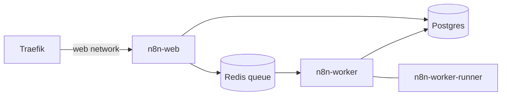

# n8n

Self-hosted n8n in queue mode, with PostgreSQL and Redis, running behind Traefik for HTTPS.

Queue mode splits the work between a main process (the editor and webhooks) and a worker process that runs your workflows. Code from Code nodes runs in a separate task runner container beside the worker, as n8n recommends for production. The main process needs no runner, because every execution, manual ones included, runs on the worker.



The runner shares a private network only with its worker, with no internet access, so code in a Code node cannot reach Postgres, Redis or anything outside. The runner image is the hardened `-distroless` variant, running as an unprivileged user with a read-only filesystem. JavaScript and Python Code nodes both work.

## Prerequisites

- Docker and Docker Compose
- Traefik running with a shared `web` external network (see the `traefik/` folder)

## Setup

1. Copy the example env file and fill in your values. Generate `N8N_ENCRYPTION_KEY` and `N8N_RUNNERS_AUTH_TOKEN` with `openssl rand -hex 32`, and keep the file private:
   ```bash
   cp .env.example .env
   chmod 600 .env
   ```

2. Create the external Docker network (skip if Traefik already made it):
   ```bash
   docker network create web
   ```

3. Start the stack:
   ```bash
   docker compose up -d --wait
   ```

The editor will be at `https://<N8N_EDITOR_SUBDOMAIN>.<DOMAIN_NAME>` once Traefik has issued the certificate.

Keep a copy of `N8N_ENCRYPTION_KEY` somewhere safe outside this server. Without it, the credentials stored in the database cannot be decrypted.

## Versions and updates

n8n and its task runner image are pinned to the same exact version, `N8N_VERSION` in `.env`. The runner image must always match n8n, so change the version only through `.env`, never in the compose file.

`update-n8n.sh` moves the stack to the newest release on an n8n update channel. n8n publishes two: `stable` is the release for production use, and `beta` is the newest release, which may be unstable. Pick one per server with `N8N_UPDATE_CHANNEL` in `.env`. The script itself is the same everywhere; every per-server choice lives in `.env`:

| `.env` setting | Default | What it does |
|---|---|---|
| `N8N_UPDATE_CHANNEL` | `stable` | Follow `n8nio/n8n:stable` or `n8nio/n8n:beta`. |
| `N8N_AUTO_UPDATE_MAJOR` | `false` | Set to `true` to also move to a new major version. |
| `N8N_UPDATE_KEEP_BACKUPS` | `7` | How many database backups to keep, newest first. |
| `N8N_VERSION` | (required) | The exact version running. The script updates this line; you only set it by hand when you first install or roll back. |

Each run:

1. Waits if an OS package upgrade (unattended-upgrades) is running, because it can restart Docker. After an hour it skips this run.
2. Reads the version the channel tag points at. If it is not newer than `N8N_VERSION`, it exits and changes nothing. It never moves to an older version, so switching a server from `beta` back to `stable` takes effect once `stable` catches up.
3. Skips a new major version (for example 2.x to 3.x) unless `N8N_AUTO_UPDATE_MAJOR=true`. Major versions have breaking changes, so read them and check **Settings > Migration Report** in n8n first.
4. Pulls the new n8n image (and the matching runner image, if the stack uses task runners), then takes a compressed PostgreSQL backup into `backups/`, readable only by its owner. n8n database migrations run on startup and cannot be rolled back, so this backup is your safety net.
5. Writes the new `N8N_VERSION` into `.env`, recreates the stack and waits for it to come up (every container healthy, where it has a health check).
6. Keeps the newest `N8N_UPDATE_KEEP_BACKUPS` backups, whatever their age, and removes old n8n images, keeping the previous version. This only happens after a successful update.

`update-n8n.sh --check` prints the channel, the running version and what a run would do, without changing the stack. Log and backup timestamps use `GENERIC_TIMEZONE` from `.env`. The settings at the top of the script (`LOG_MAX_BYTES`, `WAIT_TIMEOUT`, `APT_WAIT_MAX`) rarely need changing.

Run it daily from cron. Cron uses the server's timezone (`timedatectl` shows it). Pick a time after the server's automatic OS upgrade and any reboot that follows it. Ubuntu runs that upgrade around 06:00 by default; check yours with `systemctl list-timers apt-daily-upgrade.timer`. For example, on a server whose OS upgrade runs at 03:00:

```cron
0 4 * * * /path/to/n8n/update-n8n.sh
```

Output is appended to `update-n8n.log` next to the script, which rotates to `update-n8n.log.1` when it grows past `LOG_MAX_BYTES`.

To update by hand instead, set `N8N_VERSION` in `.env` and run `docker compose up -d --wait`. Back up the database first.

Postgres and Redis are pinned in `docker-compose.yml`. Bump them deliberately: a new minor or patch release of the same major version is a drop-in update, but a new Postgres major version needs a dump and restore.

## Getting ready for n8n 3.0

n8n 3.0 has breaking changes. Read [the v3.0 breaking changes](https://docs.n8n.io/changelog/v30-breaking-changes/) and open **Settings > Migration Report** in n8n before you upgrade. This setup already handles the parts that touch deployment:

- Task runners run in external mode, which n8n recommends and which replaces the deprecated internal mode.
- `N8N_WEBHOOK_URL` replaces the deprecated `WEBHOOK_URL`, and the deprecated `N8N_RUNNERS_ENABLED` is gone.
- Defaults that change in 3.0 are already set to their 3.0 values, so a workflow that depends on the old behavior fails now on 2.x rather than after the upgrade: the Code node time limit (`N8N_RUNNERS_TASK_TIMEOUT`, 60 seconds), unverified community packages turned off (`N8N_UNVERIFIED_PACKAGES_ENABLED`), and the Compression node limits (256 MiB and 1,000 entries). Raise them if you need to.
- `N8N_MIGRATE_FS_STORAGE_PATH=true` renames `~/.n8n/binaryData` to `~/.n8n/storage` on 2.x. n8n 3.0 refuses to start if both folders exist. Once you are on 3.0, remove this variable and `OFFLOAD_MANUAL_EXECUTIONS_TO_WORKERS`, which 3.0 also drops.

Things to check in your own workflows: removed legacy nodes (Function, Cron, Read Binary File and others), and Slack Trigger credentials needing a signing secret.

## Running more workers

The compose file defines one worker with one task runner, which is plenty for most instances. Each worker needs its own runner, so workers cannot be added with `--scale`. To run a second worker, use the ready-made override file:

```bash
cp docker-compose.override.example.yml docker-compose.override.yml
docker compose up -d --wait
```

Docker Compose loads `docker-compose.override.yml` automatically, and it is git-ignored, so `git pull` and `update-n8n.sh` keep your extra worker. It adds `n8n-worker-2` with its own runner on its own internal network. For a third worker, repeat the pattern in the same file with `-3` names.

## Notes

- `N8N_PROXY_HOPS` is the number of reverse proxies in front of n8n. Use `1` for just Traefik, or `2` if you are behind Cloudflare plus Traefik (with Traefik trusting Cloudflare's forwarded headers, see the Traefik README).
- `local-files/` is mounted inside n8n at `/files`. The Read/Write Files from Disk node can only use that folder (`N8N_RESTRICT_FILE_ACCESS_TO`).
- Custom CA certificates: add `- ./pki:/opt/custom-certificates` to the n8n volumes and put the certificates in `pki/`. The folder must be writable by the container's `node` user (UID 1000), because n8n's entrypoint indexes the certificates there on start.
- The Execute Command and Local File Trigger nodes stay disabled, which is n8n's default since 2.0.
- Dollar signs in passwords inside `.env` must be escaped by doubling them (`$$`), because Compose treats a single `$` as the start of a variable.
